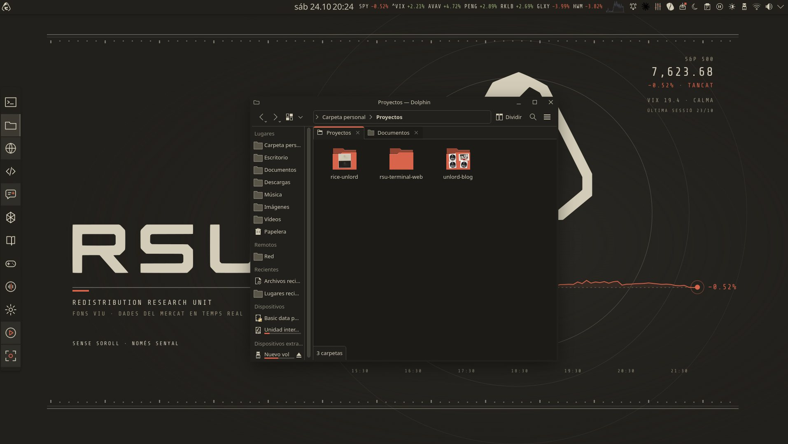
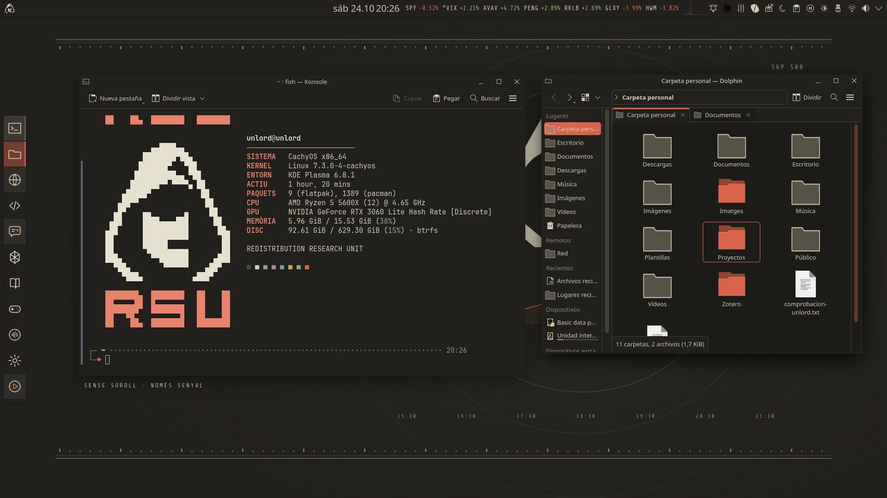
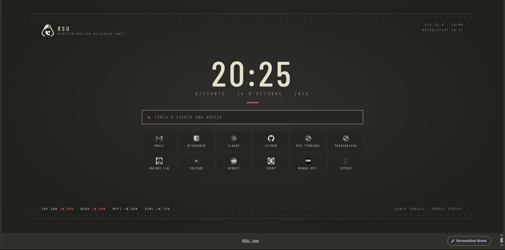
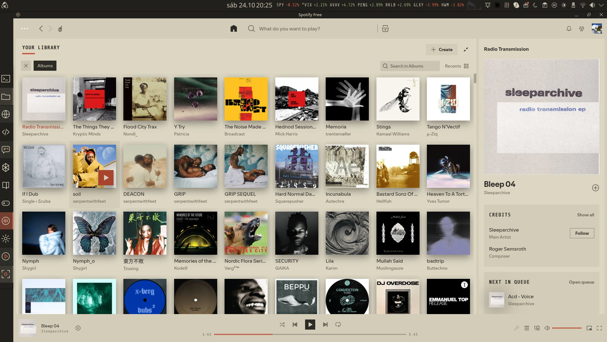

# Rice Unlord

Rice para **CachyOS + KDE Plasma 6** con la estética de [RSU](https://unlordl4b.pages.dev/posts/rsu/): papel envejecido, tinta negra y un único acento rojo. Incluye una versión nocturna, **Unlord Nit**.

Lo explico, con capturas, en el blog: **[Rice. El escritorio como territorio.](https://unlordl4b.pages.dev/posts/rice/)**



| | |
|---|---|
|  |  |
|  | |

## Qué incluye

- **Fondos** (1080p y 1440p) y un **fondo vivo** que dibuja la curva del S&P 500 del día y cambia de ambiente con el VIX: calma, tensión o pánico.
- **Colores** Unlord (claro) y Unlord Nit (oscuro) para KDE, Konsole, VS Code, btop, Spotify (Spicetify) y Brave (tema QT).
- **Iconos de línea** propios, que cambian de color con el tema (lo que falta lo toma de Breeze).
- **Cursor**, **sonidos de sistema** mínimos, **fuentes**, terminal con **fastfetch** (logo RSU) y **starship**.
- **Widget RSU · Vigilància** para el panel: índices y valores en directo, y aviso de informes RSU nuevos.
- **Pantalla de bloqueo**, tema de **GRUB** y animación de arranque **Plymouth**.
- **Elia**: asistente de voz local (Newelle + Ollama + Whisper) con la orden `rsu-estat`.
- Página de inicio **RSU · Inici** para Brave y una política que lo deja sin Rewards, Wallet, VPN ni telemetría.

## Instalar

En CachyOS (KDE Plasma), desde una terminal dentro de esta carpeta:

```bash
bash paquetes.sh          # programas que usa el rice (pide contraseña)
bash instalar.sh          # menú: elige módulos o "todo", y claro u oscuro
# cierra sesión y vuelve a entrar
bash instalar-sistema.sh  # GRUB y Plymouth (sudo, pregunta cada uno)
bash comprobar.sh         # informe en verde / amarillo / rojo
```

`instalar.sh` guarda antes una copia de tu configuración en `~/.config/unlord-backup-FECHA`. Más detalles en `LEEME.txt`.

Algunas piezas están pensadas para mi sistema (el widget lee la cartera de RSU Terminal y los iconos de proyectos apuntan a mis carpetas). Cógelas como punto de partida: copia sin vergüenza y luego cámbialo todo.
